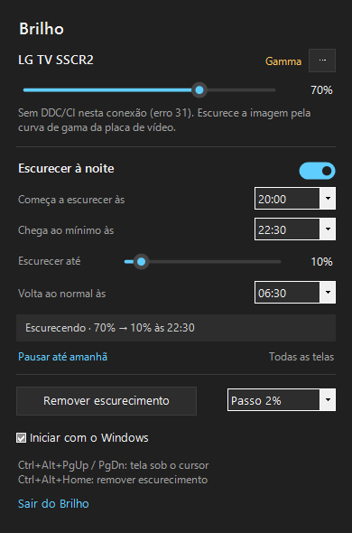

# OLED Brightness (Brilho)

**Controle de brilho por tela para Windows, feito sob medida para monitores e TVs OLED.**

O Brilho fica na bandeja do sistema e deixa você baixar o brilho de cada tela com
um controle deslizante ou um atalho. Ele vai **abaixo do mínimo** que o próprio
monitor permite e pode **escurecer a tela devagar à noite**, sozinho, voltando ao
normal de manhã.



## Por que é tão bom para OLED

Na maioria das TVs e monitores OLED usados como monitor de PC não dá para mudar o
brilho pelo Windows. A TV não aceita o comando padrão de brilho (DDC/CI), e o
controle fica escondido no controle remoto ou no menu da tela. O Brilho resolve
isso escurecendo **a própria imagem**, e no OLED isso tem um efeito especial:

- **O brilho cai de verdade.** Em OLED cada pixel é a própria fonte de luz. Uma
  imagem com metade do valor emite menos luz, porque não existe luz de fundo
  acesa por trás. Num LCD, escurecer a imagem só "tapa" a luz de fundo; num OLED,
  a luz diminui.
- **O preto continua preto.** Os pixels pretos seguem apagados em qualquer nível,
  então o contraste infinito do OLED não muda.
- **Menos desgaste.** O desgaste (e o risco de marcas) de um painel OLED cresce
  com o brilho e com o tempo ligado. Trabalhar e assistir com o brilho mais
  baixo, principalmente em longas sessões noturnas com barras de tarefas e
  janelas paradas, alivia o painel.
- **Menos consumo.** Num OLED a energia acompanha a luz emitida, então uma imagem
  mais escura também gasta menos.
- **Abaixo do mínimo da TV.** O "brilho 0" de muitas TVs OLED ainda é forte num
  quarto escuro. Com o Brilho, a imagem vai até onde você quiser, sem limite.

Também funciona em monitores LCD comuns. Neles, quando o monitor aceita DDC/CI,
o Brilho muda **a luz de fundo de verdade**, como os botões do monitor.

## Recursos

- **Um controle por tela**, no painel da bandeja, com o método usado em cada uma.
- **Escolha automática do melhor método** para cada tela (detalhes abaixo), com
  troca manual pelo botão **⋯**.
- **Escurecer abaixo do mínimo** em monitores com DDC/CI: o último quarto do
  controle deixa o monitor no mínimo e escurece a imagem.
- **Escurecer à noite**: num horário escolhido a tela começa a escurecer devagar,
  chega ao mínimo que você definiu e volta ao normal de manhã.
- **Atalhos globais** que agem na tela sob o cursor, com um indicador na tela.
- **Linha de comando** para scripts e tarefas agendadas.
- **À prova de tela preta**: o escurecimento é desfeito ao sair, ao fazer logoff
  e até depois de o app travar ou ser finalizado à força.

## Como funciona

Para cada tela o Brilho testa, nesta ordem, o que ela aceita:

| Método | Quando é usado | Como |
|---|---|---|
| **WMI** | Tela interna de notebook | O controle de brilho do próprio Windows |
| **DDC/CI** | Monitores externos que aceitam o protocolo | Comando de brilho (VCP `0x10`) pelo cabo, o mesmo dos botões do monitor. Muda a luz de fundo |
| **Gamma** | TVs e conexões sem DDC/CI (a maioria das TVs OLED por HDMI) | A curva de gama da placa de vídeo é multiplicada por um fator: 50% = imagem pela metade, 0% = preto. Acontece na saída da placa de vídeo, então vale para tudo, até o cursor, e não aparece em prints |
| **Overlay** | Quando o HDR do Windows está ligado (o Windows ignora a curva de gama em HDR) | Uma camada preta translúcida por cima da tela, que deixa os cliques passarem e fica fora de prints e gravações |

Cuidados que evitam surpresas:

- A curva original é guardada **antes** de escurecer. No Windows o escurecimento
  continua valendo mesmo se o app fechar à força, então essa cópia fica gravada
  em disco (`gamma-journal.json`). Ao reabrir, o app parte dela e nunca escurece
  "em cima do escuro".
- Ao sair do app, toda curva volta ao original.
- As preferências ficam presas ao **monitor físico e à porta**, não ao número da
  tela, que o Windows reaproveita.
- Uma tela que reaparece (cabo religado, PC acordado, app reaberto) volta com
  **pelo menos 25%** de brilho. Religar o cabo nunca dá numa tela preta.
- Comandos DDC/CI esperam 50 ms entre si, numa fila única. Um arrasto do controle
  vira um comando só, com o valor final. Ao acordar o PC, o app espera 3 s antes
  de falar com os monitores.

### Escurecer à noite

1. No horário de início (ex.: **22:00**) o app guarda o brilho atual de cada tela
   e começa a baixar devagar, numa curva suave.
2. No horário do mínimo (ex.: **23:30**) chega ao nível escolhido (ex.: **30%**)
   e fica assim. Uma tela que de dia já está abaixo desse nível não é clareada.
3. No horário de volta (ex.: **07:00**) volta ao brilho guardado em 15 minutos.

O nível é calculado pelo relógio, não contado. Se o PC ligar ou acordar no meio
da noite, a tela vai ao ponto certo em poucos segundos, e passar da meia-noite
funciona normalmente. **Se você mexer no brilho durante a noite, você manda**: o
agendamento espera até a manhã. **Pausar até amanhã** pula a noite.

## Instalação

Requer Windows 10 (2004) ou Windows 11 e o
[.NET 8 SDK](https://dotnet.microsoft.com/download/dotnet/8.0).

```bash
git clone https://github.com/vinicioShurman/oled-brightness.git
```

```bash
cd oled-brightness
```

```bash
dotnet build -c Release
```

O app fica em `bin\Release\net8.0-windows\Brilho.exe`. Para gerar um `.exe` único:

```bash
dotnet publish -c Release -r win-x64 --self-contained false -p:PublishSingleFile=true
```

Abra o `Brilho.exe`; o ícone de sol aparece na bandeja. Marque **Iniciar com o
Windows** no painel para ele abrir sozinho.

## Uso

Clique no ícone de sol para abrir o painel.

| Atalho | Ação |
|---|---|
| `Ctrl+Alt+PgUp` / `Ctrl+Alt+PgDn` | Sobe/desce o brilho da tela onde está o cursor |
| `Ctrl+Alt+Home` | Remove todo escurecimento por software (o "botão de pânico") |

Linha de comando (com o app aberto, o pedido vai para ele):

| Comando | O que faz |
|---|---|
| `Brilho.exe --list` | Lista as telas, o método e o nível |
| `Brilho.exe --set 1 40` | Põe a tela 1 em 40% (`all` para todas) |
| `Brilho.exe --reset` | Remove todo escurecimento por software |
| `Brilho.exe --quit` | Fecha o app, devolvendo as curvas |
| `Brilho.exe --simular-noite` | Mostra a curva da noite configurada, sem mexer na tela |

Dados em `%APPDATA%\Brilho`:

- `settings.json`: nível, método e agendamento.
- `brilho.log`: o método escolhido para cada tela e as falhas.
- `gamma-journal.json`: só existe enquanto há uma tela escurecida.

## Limitações

- **Gamma** em monitores **LCD** escurece a imagem, mas não a luz de fundo.
  Funciona, mas sem a economia de energia que o OLED tem. Se o LCD aceitar DDC/CI,
  esse método é usado no lugar.
- Com **HDR ligado** o Windows ignora a curva de gama, e o modo automático passa a
  usar o Overlay. O Overlay não escurece o cursor nem a tela de segurança
  (UAC, Ctrl+Alt+Del).
- Alguns jogos em tela cheia exclusiva trocam a curva de gama; o app confere a
  cada segundo e reaplica.
- Escurecer até 0% deixa a tela preta de propósito. Para voltar, use os atalhos,
  `Ctrl+Alt+Home` ou `Brilho.exe --reset`. Reiniciar o Windows também devolve a
  curva original.
- O método WMI (tela de notebook) não foi testado em hardware real ainda.

## Créditos

A ideia e as regras de segurança vêm da função de brilho do
[Vorssaint](https://github.com/vorssaint/vorssaint-utils), um utilitário de código
aberto para macOS (GPL-3.0). Este projeto é uma implementação independente para
Windows, com APIs públicas do sistema; nenhum código do Vorssaint foi copiado.
